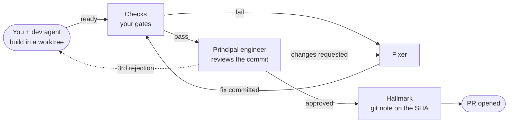

<div align="center">


# Hallmark

**Agentic development · automated review · a full record**

Coding agents build your change. An independent principal-engineer agent reviews it.<br>
Only commits that earn a **hallmark** leave your machine.

[](https://github.com/tiagocolombo/hallmark/actions/workflows/ci.yml)
[](LICENSE)
[](https://www.rust-lang.org)
[](#install)
[](https://claude.com/claude-code)

[Quick start](#quick-start) · [How it works](#how-it-works) · [Install](#install) · [Usage](#usage) · [Docs](#documentation) · [Contributing](CONTRIBUTING.md)

</div>

<br>

<picture>
  <source media="(prefers-color-scheme: dark)" srcset="docs/images/inside-the-hall-dark.gif">
  
</picture>

<p align="center"><sub>Inside the Hall: each box is an item, each figure an agent. Every handoff passes through the Post Room and is written to the journal.</sub></p>

---

## Why Hallmark

Coding agents write code quickly. Deciding whether that code should ship is
still left to you. Hallmark turns "the agent says it's done" into a loop that
holds up:

- **Independent review, bound to a commit.** A separate principal-engineer
  agent reviews a frozen commit against your base branch with fresh context.
  Its approval is a git note on that exact SHA. Change one byte and the
  approval no longer applies.
- **A fix loop that runs on its own.** Failing checks and review findings go to
  a fixer agent and back to review until the commit is approved, or until it
  needs your judgement.
- **Nothing reaches GitHub without a hallmark.** A gate in Claude Code blocks
  pushes from an item's worktree. The shipper opens the PR, and only for a
  hallmarked commit.
- **A full record.** Every prompt, commit, check, verdict, fix and decision is
  appended to a journal. You can always see what was rejected, what was fixed
  and why.
- **Budgets you set.** Every model run is measured. Caps per run, per item, per
  role and per day stop the loop before it runs away.
- **Local and private.** No server, no account. Model runs go through your own
  Claude Code. The journal lives in your git directory and is never committed.
- **Works with your tooling.** Worktree, gate and ship commands come from
  `.hallmark.toml`, with defaults for plain `git` and `gh`.

## Quick start

```sh
# 1. Install (macOS and Linux; see Install for Windows, Homebrew, Cargo and Nix)
curl --proto '=https' --tlsv1.2 -LsSf \
  https://github.com/tiagocolombo/hallmark/releases/latest/download/hallmark-installer.sh | sh

# 2. In the repository you want reviewed
cd your-repo
hall setup

# 3. Restart Claude Code, then ask for a change as usual
claude
```

`hall setup` installs the Claude Code plugin, configures the repository,
starts the review daemon and runs `hall doctor`. It is safe to run again.

Then just work. Ask Claude for a change (*"retry failed webhook deliveries"*),
or be explicit with `/hallmark <request>`. Claude opens an **item** with its
own branch and worktree, builds it with you, and sends it to review when you
say it's ready. The daemon takes it from there.

## How it works



1. **Start.** A prompt, a GitHub issue or an existing branch becomes an
   **item** (`H-0042`) with its own branch and worktree. Independent parts of a
   larger request become parallel child items.
2. **Build.** You and the dev agent iterate in Claude Code. Hooks record each
   prompt, turn and commit.
3. **Check.** When you say it's ready, the commit is frozen and your gates run
   first. A red build never spends review tokens.
4. **Review.** The principal engineer reviews the diff through seven lenses,
   using your repo's rules from the base branch and what the Library learned
   from earlier items. It reports only what it can show is broken.
5. **Fix.** A fixer agent addresses the findings, or disputes them with a
   reason, and the loop repeats. Re-reviews read only what changed.
6. **Ship.** The approved commit is rebased onto the latest base and gets its
   hallmark. The shipper opens the PR, and the Delivery Office watches it until
   it merges.

When something needs a person (a question, an escalation, an exhausted budget),
it goes to **your inbox**. You hear about it in Claude Code, in the terminal
app, on the desktop or on your phone. Only that item waits; everything else
keeps moving.

Hallmark is named after Goldsmiths' Hall in London, where silver was tested
and stamped before it could be sold. The design is laid out the same way, as a
building with rooms. See [How it works](docs/how-it-works.md) for the rooms,
the state machine and one item's full life.

## Install

**Requirements:** [git](https://git-scm.com) and
[Claude Code](https://claude.com/claude-code). [`gh`](https://cli.github.com)
is used for issues and pull requests by the default ship command.

| Method | Command |
| --- | --- |
| macOS, Linux | `curl --proto '=https' --tlsv1.2 -LsSf https://github.com/tiagocolombo/hallmark/releases/latest/download/hallmark-installer.sh \| sh` |
| Windows (PowerShell) | `powershell -ExecutionPolicy Bypass -c "irm https://github.com/tiagocolombo/hallmark/releases/latest/download/hallmark-installer.ps1 \| iex"` |
| Homebrew | `brew install tiagocolombo/tap/hall` |
| Cargo (Rust 1.88+) | `cargo install --git https://github.com/tiagocolombo/hallmark --locked` |
| Nix | `nix-build nix` from a clone, or `nix profile install --file nix` |

Prebuilt binaries cover macOS (Apple silicon and Intel), Linux (x86_64 and
arm64, glibc and musl) and Windows (x86_64), each with a SHA-256 checksum.
Then run `hall setup` in your repository.

See the [installation guide](docs/install.md) for every option, upgrading
with `hall update`, and notes for Windows.

## Usage

You don't have to mention Hallmark to Claude:

- The `hallmark` skill picks up requests like *"pick up #212"* or *"what's in
  review?"*.
- A `SessionStart` hook tells Claude whether it is working in an item.
- The edit gate denies the first edit outside an item's worktree, with a reply
  that tells Claude to run `hall new`.

From the terminal:

```sh
hall                         # the terminal app: inbox, board, journal, findings, history, usage

hall new "Retry failed webhook deliveries" --open   # item, branch, worktree; opens Claude there
hall new --issue 212         # start from a GitHub issue
hall adopt                   # turn the current branch into an item
hall adopt --pr 7            # take over an open PR

hall status                  # items by state, and what each one is doing now
hall inbox                   # everything waiting for you
hall log H-0042              # the item's journal
hall export H-0042           # the whole record as Markdown

hall ready H-0042            # freeze HEAD and queue it for review
hall pull-back H-0042        # back to development
hall drop H-0041 --reason "superseded by H-0044"

hall usage --by model --since 7d
hall budget --set per_item=800k
hall history --rejected --since 7d
```

On a terminal, commands print readable text. When an agent runs them, they
print JSON. See the [command reference](docs/commands.md) for every command.

### Built for agents

Agents are the main users of `hall`, so the CLI behaves like an API:

- JSON whenever stdout isn't a terminal, and `--json` to force it.
- Every reply includes `next`: the commands that make sense now.
- Errors are data, `{"error":{"code","message","next"}}`, with documented exit
  codes.
- Commands never prompt and are idempotent.
- `hall help --json` lists every command, and `hall schema <name>` prints the
  JSON Schema of any output.

```json
{"error":{"code":"ITEM_IN_REVIEW","message":"H-0042 is in review, round 2.","next":["hall pull-back H-0042"]}}
```

## Configuration

`.hallmark.toml` is optional. `hall init` writes one with the gates it detects
from `package.json` scripts, Cargo, Go, pytest, a Makefile or a justfile. A
repository with its own tooling overrides only the commands it needs:

```toml
base  = "main"
gates = ["cargo fmt --check", "cargo clippy --all-targets -- -D warnings", "cargo test"]
ship  = "git push -u origin {branch} && gh pr create --base {base} --head {branch} --title {title} --body-file {body_file}"

[budget]
daily    = "4M"     # tokens across the whole review loop
per_item = "800k"   # then the item waits for you

[capture]
mode = "gate"       # gate: edits need an item · ask: Claude asks first · off
```

See the [configuration reference](docs/configuration.md) for every key and its
default, including models per role, notifications and the Library.

## Where things live

| What | Where |
| --- | --- |
| The journal | `<git-common-dir>/hallmark/items/<id>/events.jsonl`: append-only, shared by every worktree, never committed (it contains your prompts) |
| The index | SQLite next to the journal. It's a cache, so `hall reindex` rebuilds it. |
| The Library | `<git-common-dir>/hallmark/library/`: learnings from closed items, kept locally |
| The hallmark | A git note under `refs/notes/hallmark` on the approved commit |
| Your settings | `.hallmark.toml` in the repo, and `<user data dir>/hallmark/config.toml` for personal settings such as notifications |

## Project status

Hallmark is in early, active development (`0.1`). The full loop runs today:
items and the journal, the gates, checks, review, fixes, shipping, delivery
tracking, parallel parts, budgets, notifications, the Library and the terminal
app. Expect the configuration and the CLI to change before `1.0`. Breaking
changes will be called out in the release notes.

Hallmark currently drives [Claude Code](https://claude.com/claude-code). Every
model run goes through `claude -p` and counts toward your Claude plan or API
usage.

## Documentation

| Document | What's in it |
| --- | --- |
| [Installation](docs/install.md) | Every install method, setup step by step, upgrading, Windows |
| [How it works](docs/how-it-works.md) | The rooms, the item state machine, one item's life, parallel parts |
| [Commands](docs/commands.md) | Every command, the agent contract and exit codes |
| [Configuration](docs/configuration.md) | Every `.hallmark.toml` key and its default |
| [Design](docs/DESIGN.md) | The design, condensed |
| [Interactive design page](docs/design.html) | The animated floor plan, state map and replay (open it from a clone) |
| [Architecture decisions](docs/decisions/) | Why things are the way they are |
| [Spikes](docs/spikes.md) | How Claude Code actually behaves, and an end-to-end run |

## Contributing

Contributions are welcome: bug reports, docs, and code. Read
[CONTRIBUTING.md](CONTRIBUTING.md) for the development setup, the checks a pull
request must pass, and the project's conventions. To report a security issue,
follow [SECURITY.md](SECURITY.md) and don't open a public issue.

## License

Hallmark is released under the [MIT License](LICENSE).
