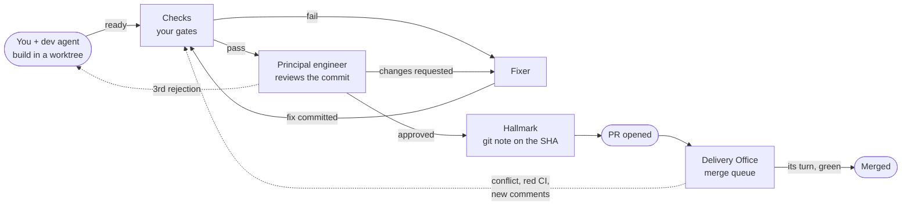
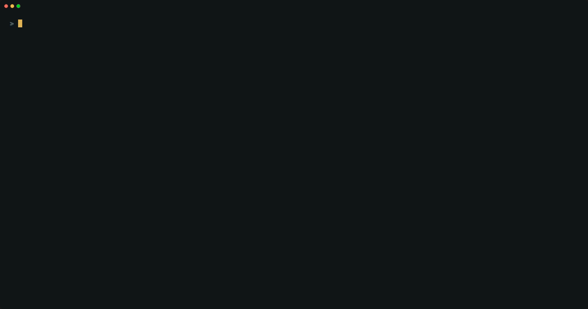
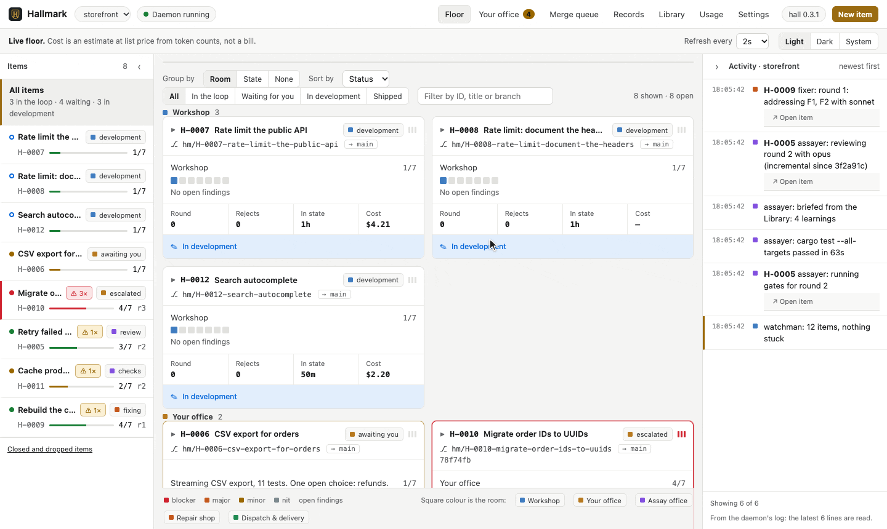

<div align="center">


# Hallmark

**Agentic development · automated review · a full record**

Coding agents build your change. An independent principal-engineer agent reviews it.<br>
Only commits that earn a **hallmark** leave your machine.

[](https://github.com/tiagocolombo/hallmark/actions/workflows/ci.yml)
[](https://github.com/tiagocolombo/hallmark/actions/workflows/audit.yml)
[](https://scorecard.dev/viewer/?uri=github.com/tiagocolombo/hallmark)
[](https://github.com/tiagocolombo/hallmark/releases)
[](LICENSE)

[](https://www.rust-lang.org)
[](#install)
[](https://claude.com/claude-code)
[](SECURITY.md)
[](https://www.conventionalcommits.org)
[](CONTRIBUTING.md)

[Website](https://hallmark.colombo.dev) · [Quick start](#quick-start) · [How it works](#how-it-works) · [Install](#install) · [Usage](#usage) · [Docs](#documentation) · [Contributing](CONTRIBUTING.md)

</div>

<br>

<picture>
  <source media="(prefers-color-scheme: dark)" srcset="docs/images/inside-the-hall-dark.gif">
  
</picture>

<p align="center"><sub>Inside the Hall: each box is an item, each figure an agent. Every handoff passes through the Post Room and is written to the journal. Shipped PRs wait in the Delivery Office's merge queue; with the merger on (`[merge] mode = "auto"`), it merges them.</sub></p>

---

## Why Hallmark

Coding agents write code quickly. Deciding whether that code should ship is
still left to you. Hallmark turns "the agent says it's done" into a loop that
holds up:

- **Independent review, bound to a commit.** A separate principal-engineer
  agent reviews a frozen commit against your base branch with fresh context.
  Its approval is a git note on that exact SHA. Change one byte and the
  approval no longer applies.
- **Untested means unfinished.** The reviewer audits the tests before
  anything else. A changed behaviour that no test would catch breaking, or a
  bug fix without a regression test, blocks approval, and the fixer writes
  the missing test first.
- **A fix loop that runs on its own.** Failing checks and review findings go to
  a fixer agent and back to review until the commit is approved, or until it
  needs your judgement.
- **Nothing reaches GitHub without a hallmark.** A gate in Claude Code blocks
  pushes from an item's worktree. The shipper opens the PR, and only for a
  hallmarked commit.
- **Watched until it merges.** The Delivery Office follows each PR: a
  conflict gets rebased, red CI goes to a fixer, and new review comments go
  back through review. `hall adopt --pr` takes over a PR that's already open.
- **Merged in order, if you want.** With `[merge] mode = "auto"`, the merger
  merges each green, hallmarked PR, one at a time, in dependency order. It
  brings each PR up to date once, at its turn, and PRs on separate files move
  in parallel lanes, so a merge doesn't send every other PR back for a rebase.
  `[merge] update = "conflicts"` merges a clean, green PR as it is, and the
  merger stops whenever the base's own CI is red. Paths you list in
  `[merge] lit` still wait for you. `hall queue` shows the order.
- **A rebase keeps its approval.** When a rebase leaves the approved change
  as it was, the hallmark carries over with no new review. When it changed
  something, the reviewer reads only that difference.
- **PRs that read well.** A shipped PR's description is What, Why, How, Testing, How to revert and Risk;
  every review, with its findings and how each was fixed, is a PR comment.
- **A full record.** Every prompt, commit, check, verdict, fix and decision is
  appended to a journal. You can always see what was rejected, what was fixed
  and why.
- **Your reasons reach the agent.** When you pull an item back, retry it or
  send it to review with a note, your words go into the next agent's prompt,
  not just the journal.
- **Budgets you set.** Every model run is measured. Caps per run (with a
  default for each role), per item, per role and per day stop the loop before
  it runs away. Gates that already passed on the same tree aren't run again.
- **Local and private.** No server, no account. Model runs go through your own
  Claude Code. The journal lives in your git directory and is never committed.
- **Works with your tooling.** Worktree, gate and ship commands come from
  `.hallmark.toml`, with defaults for plain `git` and `gh`. `hall config`
  changes any setting without editing TOML.
- **A reviewer that knows your repo.** Skills in `.hallmark/skills/` extend or
  replace how the reviewer reviews, how the fixer fixes and what development
  sessions are told. They're read from the base branch, so a branch can't
  rewrite its own review.
- **Extensions.** Turn on skills by other authors for the planner, the
  developer, the reviewer and the fixer. [Matt Pocock's
  skills](https://github.com/mattpocock/skills) are one command away:
  `hall extensions enable mattpocock`.

## Quick start

```sh
# 1. Install (Rust 1.88+; see Install for prebuilt binaries and Nix)
cargo install --git https://github.com/tiagocolombo/hallmark --locked

# 2. In the repository you want reviewed
cd your-repo
hall setup

# 3. Restart Claude Code, then ask for a change as usual
claude
```

`hall setup` installs the Claude Code plugin, configures the repository,
starts the review daemon and runs `hall doctor`. It is safe to run again.
The first time, it offers to go through every setting with you (gates, how
work ships, models, budgets, tools and notifications), each with its default,
or to skip for now. `hall setup --interactive` asks again, and `hall config`
changes any setting later.

Then just work. Ask Claude for a change (*"retry failed webhook deliveries"*),
or be explicit with `/hallmark <request>`. Claude opens an **item** with its
own branch and worktree, builds it with you, and sends it to review when you
say it's ready. The daemon takes it from there.

## How it works



1. **Start.** A prompt, a GitHub issue, a branch or an open PR becomes an
   **item** (`H-0042`) with its own branch and worktree. Independent parts of a
   larger request become parallel child items.
2. **Build.** You and the dev agent iterate in Claude Code. Hooks record each
   prompt, turn and commit.
3. **Check.** When you say it's ready, the commit is frozen and your gates run
   first. A red build never spends review tokens.
4. **Review.** The principal engineer audits the tests first, then reviews the
   diff through seven lenses, using your repo's rules and skills from the base
   branch and what the Library learned from earlier items. It reports only
   what it can show is broken.
5. **Fix.** A fixer agent addresses the findings, or disputes them with a
   reason, and the loop repeats. Re-reviews read only what changed.
6. **Ship.** The approved commit is rebased onto the latest base and gets its
   hallmark. The shipper opens the PR, and the Delivery Office watches it until
   it merges: conflicts, red CI and new review comments come back through the
   loop. A rebase that leaves the approved change as it was keeps its
   hallmark without another review.
7. **Merge.** With the merger on, each PR waits in the merge queue for its CI
   and its turn, and merges without you. PRs that touch the same files go one
   after another, and the rest in parallel.

When something needs a person (a question, an escalation, an exhausted budget),
it goes to **your inbox**. You hear about it in Claude Code, in the terminal
app, on the desktop or on your phone. Only that item waits; everything else
keeps moving.

### Why "Hallmark"

For more than seven hundred years, English silver has had to be tested before
it could be sold. At Goldsmiths' Hall in London, an assayer tested each piece,
and only one that met the standard was struck with the Hall's marks: a
*hall mark*. The stamp never said the smith was good. It said this piece had
passed, and the one who made it wasn't the one who tested it.

Hallmark works the same way. Its note on an approved commit answers the
questions the old marks did: who made it (the item), what standard it met
(the open findings), who tested it (the reviewer and round) and when (the
time). Like a mark struck on silver, it can't move to another commit. The
design is laid out the same way too, as a building with rooms. See
[How it works](docs/how-it-works.md) for the rooms, the state machine and one
item's full life, and the [website](https://hallmark.colombo.dev/#name) for the
four marks.

## Install

**Requirements:** [git](https://git-scm.com) and
[Claude Code](https://claude.com/claude-code). [`gh`](https://cli.github.com)
is used for issues and pull requests by the default ship command.

| Method | Command |
| --- | --- |
| Cargo (Rust 1.88+) | `cargo install --git https://github.com/tiagocolombo/hallmark --locked` |
| Nix | `nix-build nix` from a clone, or `nix profile install --file nix` |
| Prebuilt binaries | Installer scripts and archives, once a release is published (see the [installation guide](docs/install.md)) |

Releases will carry binaries for macOS (Apple silicon and Intel), Linux
(x86_64 and arm64 glibc, x86_64 musl) and Windows (x86_64), each with a SHA-256
checksum. Then run `hall setup` in your repository.

See the [installation guide](docs/install.md) for every option, upgrading
with `hall update`, and notes for Windows.

## Usage

You don't have to mention Hallmark to Claude:

- The `hallmark` skill picks up requests like *"pick up #212"* or *"what's in
  review?"*.
- A `SessionStart` hook tells Claude whether it is working in an item.
- The edit gate denies the first edit outside an item's worktree, with a reply
  that tells Claude to run `hall new`.

From the terminal:

```sh
hall                         # the terminal app: inbox, board, journal, findings, history, usage
hall web                     # the same and the settings, in a browser on this machine

hall new "Retry failed webhook deliveries" --open   # item, branch, worktree; opens Claude there
hall new --issue 212         # start from a GitHub issue
hall adopt                   # turn the current branch into an item
hall adopt --pr 7            # take over an open PR

hall status                  # items by state, and what each one is doing now
hall inbox                   # what only you can settle
hall log H-0042              # the item's journal
hall trace H-0042 --follow   # the reviewer or fixer at work, step by step
hall export H-0042           # the whole record as Markdown
hall gazette H-0042 --open   # its story as a newspaper page, for people

hall ready H-0042            # freeze HEAD and queue it for review
hall pull-back H-0042 --reason "split the parser out first"   # back to development; the agent reads why
hall drop H-0041 --reason "superseded by H-0044"
hall queue                   # the merge queue: the order PRs merge in, and why each waits

hall usage --by model --since 7d
hall budget --set per_item=800k
hall history --rejected --since 7d
hall stats --since 30d       # reviews to approval, finding outcomes, the reviewer's noise
hall eval --dry-run           # the reverted changes the reviewer let through, scored then
hall eval --limit 5           # replay today's reviewer on them: did it catch them now?

hall extensions              # skills by other authors, with credits, per role
hall extensions enable mattpocock   # Matt Pocock's skills for the planner, developer, reviewer and fixer
```

On a terminal, commands print readable text. When an agent runs them, they
print JSON. See the [command reference](docs/commands.md) for every command.

### The terminal app

Run `hall` with no arguments to watch the whole building live: your office
(everything waiting for you), the board, each item's journal and findings, and
what the daemon is doing. It updates as the journal changes, and closing it
never stops work. The selected item says why it waits for you, and the key bar
offers only the actions that fit its state: an escalated item offers retry,
pull back and drop, never ready. When the Live view says a reviewer or fixer
run started, press <kbd>t</kbd> on the item to follow that run step by step:
what the agent reads, runs and says, and how the run ended. <kbd>[</kbd> and
<kbd>]</kbd> step through the item's earlier runs. With the merger on,
<kbd>m</kbd> shows the merge queue: the order PRs merge in, and what each one
waits for. <kbd>?</kbd> lists every key.

<picture>
  <source media="(prefers-color-scheme: dark)" srcset="docs/images/tui-board.gif">
  
</picture>

<details>
<summary><b>More: your office, findings, diffs, usage and history</b></summary>
<br>

**Your office.** Every entry explains why it waits, shows the evidence, and lists
what you can do. Press <kbd>1</kbd>–<kbd>9</kbd> to run an action, such as
answering an agent's question.



**Review detail.** The findings with their scenario and fix, the diff at any
round, tokens and cost by room, model or day, and the history of closed and
dropped items.


<sub>The demo data is fictional.</sub>
</details>

### The web app

Run `hall web` for the same building in a browser, on this machine only: the
floor, each item's journal, findings, diff and runs (followed live), your
office, the merge queue, the records and the Library, usage and budgets, and
every setting, with the daemon, `doctor` and extensions. It is one screen:
the open items on the left, the view in the middle, the daemon's activity on
the right, in a light, dark or system theme. Each button runs the `hall`
command the item offers, so the web app can do what you'd do in a terminal
and nothing more. When a newer `hall` is out, the top bar says so, and
*Update and restart* installs it and brings the page back
([ADR 0052](docs/decisions/0052-the-web-app.md)).

### The Gazette

Each finished item gets a Gazette: a newspaper page about it, written for
people rather than agents. It says what changed and why, gives each review
round's verdict and what was caught and fixed in plain words, and lists
what shipped still open. It shows the mockups and screenshots the agent
attached and, when it helps, a diagram of the flow. Hallmark sets every
fact from the journal, and the librarian writes the words in the same
cheap run that distils learnings. Open it with `hall gazette <id> --open`,
<kbd>n</kbd> in the terminal app, or the item's Gazette tab in the web app
([ADR 0053](docs/decisions/0053-the-gazette.md)).



<sub>The demo data is fictional.</sub>

### Built for agents

Agents are the main users of `hall`, so the CLI behaves like an API:

- JSON whenever stdout isn't a terminal, and `--json` to force it.
- Every reply includes `next`: the commands that make sense now.
- Errors are data, `{"error":{"code","message","next"}}`, with documented exit
  codes.
- Commands never prompt (only the setup wizard asks, on a terminal) and are
  idempotent.
- `hall help --json` lists every command, and `hall schema <name>` prints the
  JSON Schema of any output.

```json
{"error":{"code":"ITEM_IN_REVIEW","message":"H-0042 is in review, round 2.","next":["hall pull-back H-0042"]}}
```

## Configuration

`.hallmark.toml` is optional. `hall init` writes one with the gates it detects
from `package.json` scripts, Cargo, Go, pytest, a Makefile or a justfile. A
repository with its own tooling overrides only the commands it needs:

```toml
base  = "main"
gates = ["cargo fmt --check", "cargo clippy --all-targets -- -D warnings", "cargo test"]
ship  = "git push -u origin {branch} && gh pr create --base {base} --head {branch} --title {title} --body-file {body_file}"

[budget]            # these two are the defaults; "none" turns a cap off
daily    = "4M"     # tokens across the whole review loop
per_item = "800k"   # then the item waits for you

[capture]
mode = "gate"       # gate: edits need an item · ask: Claude asks first · off
```

See the [configuration reference](docs/configuration.md) for every key and its
default, including models per role, notifications and the Library.

## Where things live

| What | Where |
| --- | --- |
| The journal | `<git-common-dir>/hallmark/items/<id>/events.jsonl`: append-only, shared by every worktree, never committed (it contains your prompts) |
| The index | SQLite next to the journal. It's a cache, so `hall reindex` rebuilds it. |
| The Library | `<git-common-dir>/hallmark/library/`: learnings from closed items, kept locally |
| The hallmark | A git note under `refs/notes/hallmark` on the approved commit |
| Repo skills | `.hallmark/skills/<name>/SKILL.md`, read from the base branch |
| Extensions | Embedded in `hall`; `[extensions]` in `.hallmark.toml` turns them on per role |
| Your settings | `.hallmark.toml` in the repo, and `<user data dir>/hallmark/config.toml` for personal settings such as notifications |

## Project status

Hallmark is in early, active development (`0.2`). The full loop runs today:
items and the journal, the gates, checks, test-first review, fixes, shipping,
delivery tracking, the merger and its merge queue, parallel parts, budgets,
notifications, the Library, repo skills, extensions and the terminal app.
Expect the configuration and the CLI to change before `1.0`. Breaking changes
will be called out in the release notes.

Hallmark currently drives [Claude Code](https://claude.com/claude-code). Every
model run goes through `claude -p` and counts toward your Claude plan or API
usage.

## Documentation

| Document | What's in it |
| --- | --- |
| [Installation](docs/install.md) | Every install method, setup step by step, upgrading, Windows |
| [How it works](docs/how-it-works.md) | The rooms, the item state machine, one item's life, parallel parts |
| [Commands](docs/commands.md) | Every command, the agent contract and exit codes |
| [Configuration](docs/configuration.md) | Every `.hallmark.toml` key and its default |
| [Design](docs/DESIGN.md) | The design, condensed |
| [Interactive design page](docs/design.html) | The animated floor plan, state map and replay (open it from a clone) |
| [Architecture decisions](docs/decisions/) | Why things are the way they are |
| [Spikes](docs/spikes.md) | How Claude Code actually behaves, and an end-to-end run |

## Contributing

Contributions are welcome: bug reports, docs, and code. Read
[CONTRIBUTING.md](CONTRIBUTING.md) for the development setup, the checks a pull
request must pass, and the project's conventions. To report a security issue,
follow [SECURITY.md](SECURITY.md) and don't open a public issue.

## License

Hallmark is released under the [MIT License](LICENSE).

## Credits

Hallmark embeds skills by other authors as extensions, unchanged and under
their own licenses. `hall extensions` lists them with their credits.

| Extension | Author | License | Source |
| --- | --- | --- | --- |
| `mattpocock` | Matt Pocock | MIT ([text](extensions/mattpocock/LICENSE)) | [github.com/mattpocock/skills](https://github.com/mattpocock/skills) |

Thank you to Matt Pocock for skills that made Hallmark's roles better.
