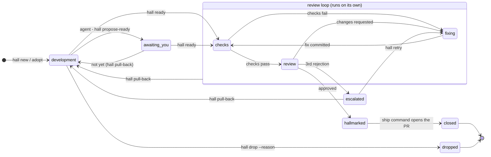

# Hallmark

*Agentic development · automated review · a full record*

Hallmark is a local, agent-first development loop for any git repository, driven
from Claude Code.

1. You start work with a prompt or a GitHub issue.
2. Dev agents build it with you.
3. When you say it's ready, an independent "principal engineer" agent reviews
   it.
4. A fixer agent addresses the findings, and the loop repeats until the commit
   earns a **hallmark**: an approval bound to that exact SHA.
5. Only hallmarked commits are pushed and opened as PRs.

Every step is written to an append-only journal, so you can always see what was
rejected, fixed and passed, and why.

The crate is `hallmark` and the command is `hall`. It is one Rust binary, for
macOS, Linux and Windows.

> This repository is private for now.

## Status

**Stages 1–3 are built.** The loop runs on its own:

- **Stage 1, the journal and hooks:** the `hall` binary and its agent
  contract, items and their state machine, the journal and its SQLite index,
  the Claude Code hooks with the edit and push gates.
- **Stage 2, the review loop:** the daemon (checks, the principal engineer's
  review, the fixer, the shipper, the watchman), hallmarks as git notes, the
  Front Desk's intake plan with parallel parts, budgets at four levels,
  resuming sessions on an answer, notifications (desktop, ntfy, Telegram,
  Slack, a morning digest), and the Library of learnings with its librarian.
- **Stage 3, the terminal app and releases:** `hall` opens the board,
  journal, findings, history, live, usage and repos views; releases are
  configured with dist and a Nix package (dry-run only, nothing published).

A live end-to-end run with Haiku in every role is recorded in
[`docs/spikes.md`](docs/spikes.md#end-to-end-stage-2).

## How it works

The full design is an interactive page:
[`docs/design.html`](docs/design.html). It includes an animated floor plan, the
state map, a step-by-step replay of one item, and mockups of the inbox and
usage views. GitHub shows it as source, so open it from a clone
(`open docs/design.html` on macOS, `xdg-open` on Linux, `start` on Windows).

Hallmark is laid out like a building, named after Goldsmiths' Hall in London,
where silver was tested and stamped before it could be sold. Each piece of work
is an **item**, and it moves from room to room:

| Room | What happens there | Who works there |
| --- | --- | --- |
| Front Desk | A request becomes an item, with a branch and a worktree | `hall new`, `hall adopt` |
| Workshop | You and the dev agent build it; each bench is a worktree | your Claude Code session |
| Your Office | Questions, "looks done?", escalations: your inbox | you (`hall inbox`) |
| Post Room | Every handoff passes through and is recorded | the `hall` CLI, the watchman |
| Records | The journal: every prompt, commit, check, verdict and decision | `hall log` |
| Library | What closed items taught, briefed to each review | the librarian |
| Assay Office | The checks, then the principal engineer's review | the assayer |
| Repair Shop | A fixer addresses failing checks and findings | the fixer |
| Stamping Room | The approved commit gets its hallmark, a git note | the assayer |
| Dispatch Dock | The ship command opens the PR, and the item closes | the shipper |

An item's states:



Any live item can be dropped with a reason. Closing ends an item's life: later
PR feedback starts a new item.

One item's life, from the replay in the design page:

1. **09:12** You type `/hallmark Retry failed webhook deliveries`. Claude runs
   `hall new`, which creates H-0042 with its own branch and worktree.
2. **09:14–09:50** You and the agent iterate. Hooks record each prompt, turn
   and commit.
3. **09:51** The agent thinks it's done and runs `hall propose-ready`. You say
   "not yet: cap it at 6 attempts".
4. **10:04** You say ready. `hall ready` freezes the commit and queues it.
5. **10:09** The checks fail, so no review tokens are spent. The fixer adds tests.
6. **10:24** The principal engineer finds a blocker and a major. The fixer
   addresses both.
7. **10:46** The review approves, and the commit gets its hallmark.
8. **10:47** The shipper opens PR #191 and the item closes. The whole record
   stays in the journal.

Every step runs today: steps 5–8 are the daemon's work.

**Parallel parts.** When a request splits into independent parts, the Front
Desk (a small Haiku run) makes a parent item and one child item per part, each
with its own worktree. Your Claude session orchestrates them: one subagent per
part, in parallel. `hall merge` folds each finished part into the parent's
branch, and the principal engineer reviews the parent once, as a whole.

## Install

See [`docs/install.md`](docs/install.md) for every method. In short:

```sh
cargo install --git ssh://git@github.com/tiagocolombo/hallmark   # or a release, or Nix
```

Releases (shell and PowerShell installers, Homebrew) are configured but not
published while the repository is private; `docs/install.md` shows how to
install from a release with `gh`. With Nix, `nix build .#hall`; `nix develop`
gives the contributor toolchain.

## Setup

One command, in the repository you want reviewed:

```sh
hall setup
```

It does every step, reports each one, and is safe to repeat (re-run it after
upgrading `hall`; it restarts the daemon on the new binary):

1. installs the Claude Code plugin and points Claude Code's status line at
   `hall statusline` (keeps someone else's status line unless `--force`);
2. sets up the repo (`hall init`), and says what to commit;
3. starts the daemon and its login service, with the PATH you ran it from
   (so `nix`, `gh` and your toolchain are found);
4. creates a private phone topic if you have none;
5. runs `hall doctor`.

`--dry-run` shows the plan; `--no-statusline`, `--no-daemon` and `--no-notify`
skip a step. In this repository, `dev install` installs `hall` from the
checkout and runs `hall setup` (it's `cargo install --path . --locked && hall
setup` inside `nix develop`).

**What `hall init` writes:**

- `.hallmark.toml`, with the gates it detects from package.json scripts, Cargo,
  Go, pytest, a Makefile or a justfile
- a stub `.hallmark/review.md`
- a short Hallmark section in CLAUDE.md or AGENTS.md

**What `hall setup claude` installs:** the plugin, with the `hallmark`,
`principal-review` and `hallmark-fix` skills, the principal-engineer, fixer,
intake and librarian agents, the verdict and plan schemas, and hooks that call
`hall hook <event>`. `--statusline` points Claude Code's status line at
`hall statusline`.

## Using it

You don't have to mention Hallmark to Claude.

- The skill picks up requests like "pick up #212" or "what's in review?".
- A `SessionStart` hook tells Claude whether it's in an item.
- The edit gate denies the first edit outside an item's worktree, with a reply
  that says to run `hall new`.

From the terminal:

```sh
hall new "Retry failed webhook deliveries" --open   # item, branch, worktree; opens Claude there
hall new --issue 212                                # start from a GitHub issue
hall adopt                                          # turn the current branch into an item

hall status                 # items by state
hall log H-0042             # the item's journal
hall inbox                  # everything waiting for you

hall ready H-0042           # freeze HEAD and queue it for review
hall pull-back H-0042       # back to development
hall drop H-0041 --reason "superseded by H-0044"
hall usage --by model --since 7d

hall                        # the terminal app: board, journal, findings, history, live, usage, repos
hall history --rejected --since 7d
hall export H-0042          # the whole record as Markdown
hall budget                 # caps and today's spend; --set per_item=800k
hall daemon status
hall library search "webhook retries"
```

On a terminal these commands print readable text. When an agent runs them, they
print JSON.

## The agent contract

Agents are the main users of `hall`, so every command follows these rules:

- **Output.** JSON when stdout isn't a TTY; `--json` forces it.
- **No prompts.** `hall` never prompts. Destructive actions need explicit flags,
  such as `--reason`.
- **Idempotent.** Repeating a command returns the current result.
- **`next`.** Every reply includes `next`: the commands that make sense now.
- **Errors.** They are data, with a documented exit code.
- **Self-describing.** `hall help --json` lists the commands, and
  `hall schema <command>` prints the output shape.
- **Location-aware.** Inside an item's worktree, the item ID is optional.

```json
{"error":{"code":"ITEM_IN_REVIEW","message":"H-0042 is in review, round 2.","next":["hall pull-back H-0042"]}}
```

| Exit | Meaning |
| --- | --- |
| 0 | done |
| 1 | internal error |
| 2 | bad arguments |
| 3 | not found |
| 4 | not allowed in the item's current state |
| 5 | denied by the gate |
| 6 | checks failed |
| 7 | claimed by another agent |

## Commands

| Command | Does |
| --- | --- |
| `hall` | Opens the terminal app on a TTY; prints the status as JSON otherwise. |
| `hall init` | Sets up a repo. `--capture gate\|ask\|off`, `--base`, `--no-claude-md` |
| `hall doctor` | Checks the install. |
| `hall setup claude` | Installs the Claude Code plugin. `--statusline`, `--dry-run` |
| `hall new [<request>]` | Creates an item and its worktree; splits into parallel parts when it can. `--title`, `--issue <n>`, `--no-split`, `--parent <id>`, `--follow-up <pr>`, `--open`, `--branch` |
| `hall adopt` | Turns the current branch and worktree into an item. |
| `hall merge [<child>]` | Merges a parallel part into its parent's branch and closes it. |
| `hall status [<id>]` | Lists items by state, or shows one item. `--all` includes closed and dropped items. |
| `hall log [<id>]` | Prints the journal. `--kind <event>`, `--limit <n>` |
| `hall inbox` | Everything waiting for you: questions, "ready?", escalations, holds, stuck items, waiting sessions. |
| `hall ready [<id>]` | Freezes the commit and queues the item for review. |
| `hall pull-back [<id>]` | Returns the item to development. |
| `hall drop [<id>] --reason <r>` | Abandons the item. The branch and journal stay. `--keep-worktree` |
| `hall retry [<id>] --reason <r>` | Allows an escalated item one more round, or releases a held item. |
| `hall propose-ready [<id>] --summary <s>` | The agent says the work looks done. |
| `hall ask <question>` | Asks you a question. `--options a,b`, `--default`, `--wait 4h`, `--item`, `--session` |
| `hall answer <qid> <answer>` | Answers; the daemon resumes the asking session with it. |
| `hall history` | Closed and dropped items, and why things were rejected. `--rejected`, `--lens`, `--since`, `--all` |
| `hall export [<id>]` | The item's whole record as Markdown. `--out` |
| `hall usage` | Tokens and list-price cost. `--by item\|room\|role\|model\|day`, `--since`, `--item` |
| `hall budget` | The caps at four levels, with today's spend. `--set key=value` |
| `hall daemon start\|stop\|status\|run` | The review loop. `--at-login`; `run --once --only <workers>` |
| `hall notify test` | Sends a test notification to every channel. `--channel` |
| `hall statusline` | One line for Claude Code's status line. |
| `hall library search\|review\|retire\|distill` | The Library of learnings. |
| `hall next --role assayer\|fixer\|shipper` | Claims work with a lease (agents). |
| `hall findings [<id>]` | Open findings and failing checks (the fixer). |
| `hall fixed <ids>` | Records what a commit fixes, or `--dispute <id> --reason` (the fixer). |
| `hall verdict --file <json>` | Records a schema-checked verdict (the assayer). |
| `hall reindex` | Rebuilds the SQLite index from the journals. |
| `hall help --json` | Lists the commands, for agents. |
| `hall schema <name>` | Prints a JSON Schema: any command's output, `error`, `event`, `config` or `verdict-input`. |
| `hall hook <event>` | The entry point for Claude Code hooks. |

## Configuration

`.hallmark.toml` is optional, and `hall` reads it from the main checkout, so an
item can't change its own gate from its worktree. These are the defaults:

```toml
base        = "main"
worktree    = "git worktree add ../{repo}-{id} -b {branch}"
branch      = "hm/{id}-{slug}"
ship        = "git push -u origin {branch} && gh pr create --base {base} --head {branch} --title {title} --body-file {body_file}"
gates       = []
fixer       = "claude -p"   # or another fix engine, run in the worktree
max_rejects = 3
stuck_after = "30m"
lenses      = "all"
rules       = ["CLAUDE.md", "AGENTS.md"]

[capture]
mode = "gate"   # gate: edits need an item · ask: Claude asks you · off

[intake]
split     = "auto"   # or "off"
max_parts = 4

[budget]                       # no caps unless you set them
review_model    = "opus"
fix_model       = "sonnet"
intake_model    = "haiku"
librarian_model = "haiku"
# daily = "4M"; per_item = "800k"
# [budget.review] max_usd = 3.0, daily = "2M", effort = "high", timeout = "20m"

[library]
search         = "builtin"   # or "qmd"
briefing_limit = "6k"
retire_after   = "90d"
```

Notification channels usually live in your user config,
`<user data dir>/hallmark/config.toml`, so your phone topic stays out of the
repo:

```toml
[notify]
phone       = "ntfy://ntfy.sh/hallmark-7f3k2q"   # or telegram://<token>@<chat>
slack       = "https://hooks.slack.com/…"
quiet_hours = "22:00-07:30"
remind      = "2h"
digest      = "08:30"
```

A repo with its own tooling overrides only the commands:

```toml
worktree = "dev wt new {branch}"
ship     = "dev submit --pr"
gates    = ["dev test", "dev run build"]
```

## Where things live

- **The journal** is append-only JSONL at
  `$(git rev-parse --git-common-dir)/hallmark/items/<id>/events.jsonl`.
  - Every worktree shares it.
  - It is never committed, because it includes your prompts.
  - A SQLite index next to it can be rebuilt at any time with `hall reindex`.
  - Review reports, check logs and raw model results sit next to the journal
    (`reviews/`, `checks/`, `runs/`).
- **The hallmark** is a git note under `refs/notes/hallmark` on the approved
  commit.

## Documentation

- [`docs/design.html`](docs/design.html): the interactive design page.
- [`docs/DESIGN.md`](docs/DESIGN.md): the design, condensed, with the decisions.
- [`docs/decisions/`](docs/decisions/): architecture decision records.
- [`docs/spikes.md`](docs/spikes.md): Step 0, which checked how Claude Code
  actually behaves, and the Stage 2 end-to-end run.
- [`docs/install.md`](docs/install.md): every way to install.
- [`CLAUDE.md`](CLAUDE.md): build, test and lint commands for contributors.
