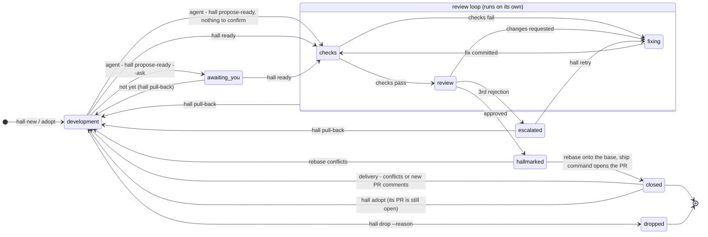

# How Hallmark works

Hallmark is laid out like a building, named after Goldsmiths' Hall in London,
where silver was tested and stamped before it could be sold. Each piece of work
is an **item**, and it moves from room to room. The interactive version of this
page, with the animated floor plan, the state map and a step-by-step replay, is
[`design.html`](design.html). Open it from a clone (`open docs/design.html` on
macOS, `xdg-open` on Linux, `start` on Windows).

## The rooms

| Room | What happens there | Who works there |
| --- | --- | --- |
| Front Desk | A request becomes an item, with a branch and a worktree | `hall new`, `hall adopt` |
| Workshop | You and the dev agent build it; each bench is a worktree | your Claude Code session |
| Your Office | Questions, "looks done?", escalations: your inbox | you (`hall inbox`) |
| Post Room | Every handoff passes through and is recorded | the `hall` CLI, the watchman |
| Records | The journal: every prompt, commit, check, verdict and decision | `hall log` |
| Library | What closed items taught, briefed to each review; kept locally, never committed | the librarian |
| Assay Office | The checks, then the principal engineer's review | the assayer |
| Repair Shop | A fixer addresses failing checks and findings | the fixer |
| Stamping Room | The approved commit gets its hallmark, a git note | the assayer |
| Dispatch Dock | Rebases onto the latest base, then the ship command opens the PR (or `update` updates an adopted one), and the item closes | the shipper |
| Delivery Office | Watches each PR until it merges. A conflict or new review comments send it back to development, where a headless dev run rebases it or addresses them and sends it to review | the delivery and delivery-watch workers, the CI watch |

## An item's states

Any live item can be dropped with a reason. Closing ends an item's life: later
PR feedback starts a new item. The exception is a PR that needs a rebase or a
conflict fix while it is still open: `hall adopt` brings its item back to
development, and after review the shipper updates the same PR
([ADR 0029](decisions/0029-adopt-open-prs.md)).

State is never stored directly. It is folded from the journal's events
([ADR 0008](decisions/0008-state-derived-from-journal.md)), so the journal is
the single source of truth.

## One item's life

From the replay in the design page:

1. **09:12** You type `/hallmark Retry failed webhook deliveries`. Claude runs
   `hall new`, which creates H-0042 with its own branch and worktree.
2. **09:14–09:50** You and the agent iterate. Hooks record each prompt, turn
   and commit.
3. **09:51** The agent thinks it's done, but the retry cap is a judgement
   call, so it runs `hall propose-ready --ask`. You say "not yet: cap it at 6
   attempts". (With nothing to confirm, `propose-ready` sends it straight to
   review.)
4. **10:04** You say ready. `hall ready` freezes the commit and queues it.
5. **10:09** The checks fail, so no review tokens are spent. The fixer adds
   tests.
6. **10:24** The principal engineer finds a blocker and a major. The fixer
   addresses both.
7. **10:46** The review approves, and the commit gets its hallmark.
8. **10:47** The shipper opens PR #191 and the item closes. The whole record
   stays in the journal.

Steps 5–8 are the daemon's work.

## Parallel parts

When a request splits into independent parts, the Front Desk (a small model
run) makes a parent item and one child item per part, each with its own
worktree. Your Claude session orchestrates them: one subagent per part, in
parallel. `hall merge` folds each finished part into the parent's branch, and
the principal engineer reviews the parent once, as a whole
([ADR 0024](decisions/0024-parallel-parts-and-follow-ups.md)).

## How Claude knows to use Hallmark

You don't need to mention Hallmark. Four things work together, from the most
explicit to the one that can't be skipped:

1. **`/hallmark <request>`**, a slash command from the plugin's skill, always
   starts a new item.
2. **A `SessionStart` hook** tells Claude whether this worktree belongs to an
   item, what state it's in, and how to start one. `hall init` adds the same
   rule to CLAUDE.md or AGENTS.md.
3. **The `hallmark` skill's description** covers starting work, picking up
   issues and asking about status, so "pick up #212" or "what's in review?"
   loads it.
4. **The edit gate**, a `PreToolUse` hook, denies the first file edit or
   commit outside an item's worktree. The denial says exactly what to run, so
   Claude creates the item and carries on. `[capture] mode` sets it to `gate`,
   `ask` or `off`.

## Extensions

A repo can turn on skills by other authors for Hallmark's roles: Matt
Pocock's skills, for one, with `hall extensions enable mattpocock`
([ADR 0038](decisions/0038-extensions.md)). Each role gets the skills that
fit its job:

- **The Front Desk** (planner) reads `to-tickets` while it plans, so it sees
  the request as tickets with blocking edges; any edge keeps it one item.
- **Development sessions** (developer) are told which skills are on and when
  each applies (`tdd`, `diagnosing-bugs`, `codebase-design`), and read one
  with `hall extensions show` when the work calls for it.
- **The reviewer** applies `code-review`'s two axes, spec and standards, and
  its smell baseline, and still answers with a verdict.
- **The fixer** fixes test-first with `tdd`, and builds a feedback loop with
  `diagnosing-bugs` when a cause isn't plain.

The text is the author's, unchanged and credited; Hallmark's instructions
and your repo's rules win where they disagree. `hall extensions` lists every
extension with its author, source and license.

## When Hallmark needs you

Only escalations land in Your Office as inbox entries: a question from an
agent, an escalation after repeated rejections, "looks done?", a budget hold,
CI that still fails after the Delivery office's two fixes, or CI that never
started (one `ci_down` entry). Hallmark tells you in Claude Code (a hook and
the status line), in the terminal app, with a desktop notification, and on
your phone through [ntfy](https://ntfy.sh), Telegram or Slack, plus an
optional morning digest.

Stuck items, Claude Code sessions waiting for permission, CI on merged PRs and
proposed learnings are notices: `hall inbox --notices` lists them, and they are
never notified.

When an agent asks a question, its session ID is saved. When you answer
(`hall answer`, the terminal app, or just telling Claude), the daemon resumes
that session with your answer, so the agent keeps its context.
