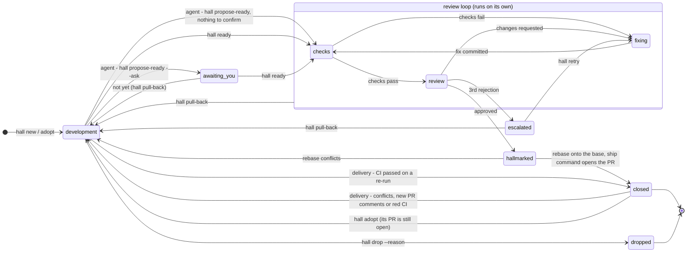

# How Hallmark works

Hallmark is laid out like a building, named after Goldsmiths' Hall in London,
where silver was tested and stamped before it could be sold. Each piece of work
is an **item**, and it moves from room to room. The interactive version of this
page, with the animated floor plan, the state map and a step-by-step replay, is
[`design.html`](design.html). Open it from a clone (`open docs/design.html` on
macOS, `xdg-open` on Linux, `start` on Windows).

## The rooms

| Room | What happens there | Who works there |
| --- | --- | --- |
| Front Desk | A request becomes an item, with a branch and a worktree | `hall new`, `hall adopt` |
| Workshop | You and the dev agent build it; each bench is a worktree | your Claude Code session |
| Your Office | Questions, "looks done?", escalations: your inbox | you (`hall inbox`) |
| Post Room | Every handoff passes through and is recorded | the `hall` CLI, the watchman |
| Records | The journal: every prompt, commit, check, verdict and decision | `hall log` |
| Library | What closed items taught, briefed to each review; kept locally, never committed | the librarian |
| Assay Office | The checks, then the principal engineer's review | the assayer |
| Repair Shop | A fixer addresses failing checks and findings | the fixer |
| Stamping Room | The approved commit gets its hallmark, a git note | the assayer |
| Dispatch Dock | Rebases onto the latest base, then the ship command opens the PR with a What, Why and How description (or `update` updates an adopted one), posts the review as a PR comment, and the item closes | the shipper |
| Delivery Office | Watches each PR until it merges. A conflict or new review comments send it back to development, where a headless dev run rebases it or addresses them and sends it to review. With the merger on, it merges each ready PR itself, one at a time, in dependency order, and brings each PR up to date only at its turn. Once the PR merges or closes, the item's worktree is removed; its branch and journal stay | the delivery and delivery-watch workers, the merger, the CI watch, the sweeper |

## An item's states

Any live item can be dropped with a reason. Closing ends an item's life: later
PR feedback starts a new item. The exception is a PR that needs a rebase or a
conflict fix while it is still open: `hall adopt` brings its item back to
development, and after review the shipper updates the same PR
([ADR 0029](decisions/0029-adopt-open-prs.md)).

An item sent back with a rebase request waits for it: `hall ready` refuses
while its branch isn't on its base, so review never sees a commit that
conflicts, and the request stays until the Delivery office (or you) rebases
it ([ADR 0043](decisions/0043-ready-waits-for-a-pending-rebase.md)).

A rebase keeps the approval it earned
([ADR 0049](decisions/0049-a-rebase-keeps-its-approval.md)). When the commit
in review is a rebase of the hallmarked one, the review step compares the
approved change with the rebased one. If they are the same change, the gates
that just passed are enough: the approval is carried and no review runs. If
resolving conflicts changed a little of it, the reviewer reads only that
difference and checks that both sides survived. A larger change gets a full
review.

An item sent back to fix its PR's red CI goes back to the PR, unchanged, if
the checks pass on a re-run (a flaky test, a runner outage). The Delivery
office reads the checks again before its fix run, and the CI watch keeps
reading them while the item waits for you, so a green re-run clears the
inbox entry without a `hall retry`. The fix run, when one is needed, gets the
checks that fail now and the failed job's own log
([ADR 0047](decisions/0047-a-ci-fix-clears-when-ci-goes-green.md)).

State is never stored directly. It is folded from the journal's events
([ADR 0008](decisions/0008-state-derived-from-journal.md)), so the journal is
the single source of truth.

## One item's life

From the replay in the design page:

1. **09:12** You type `/hallmark Retry failed webhook deliveries`. Claude runs
   `hall new`, which creates H-0042 with its own branch and worktree.
2. **09:14–09:50** You and the agent iterate. Hooks record each prompt, turn
   and commit.
3. **09:51** The agent thinks it's done, but the retry cap is a judgement
   call, so it runs `hall propose-ready --ask`. You say "not yet: cap it at 6
   attempts". (With nothing to confirm, `propose-ready` sends it straight to
   review.)
4. **10:04** You say ready. `hall ready` freezes the commit and queues it.
5. **10:09** The checks fail, so no review tokens are spent. The fixer adds
   tests.
6. **10:24** The principal engineer finds a blocker and a major. The fixer
   addresses both.
7. **10:46** The review approves, and the commit gets its hallmark.
8. **10:47** The shipper opens PR #191 and the item closes. The whole record
   stays in the journal.
9. **11:30** PR #191 merges: you merge it, or, with `[merge] mode = "auto"`,
   the merger does once its CI is green and nothing ahead of it in the queue
   is ready ([ADR 0048](decisions/0048-the-merger.md)). The Delivery office
   records it, and the sweeper removes H-0042's worktree. The branch stays
   ([ADR 0040](decisions/0040-sweep-finished-worktrees.md)).

Steps 5–9 are the daemon's work. Each model run in them (the review, a fix)
is a headless `claude -p` run, and it streams into the item's `runs/`
directory as it goes: one file per run, with what the agent read, ran and
said, ended by a line saying how the run ended
([ADR 0041](decisions/0041-watch-runs-live.md)).

The checks are a script, and a gate that passed on a tree isn't run again
on the same tree: its result comes from the checks cache, marked `cached`,
with the original run's log. Gates run in order, so every gate before one
that has to run runs too, and only the gates after it are served. Only passes are served, so a failing gate runs
again on every retry. `gates_no_cache` lists gates that must always run, such
as network tests ([configuration](configuration.md#cached-gate-results)).

## The merge queue

The merger is the Delivery office's last step, off until you set
`[merge] mode = "auto"` ([ADR 0048](decisions/0048-the-merger.md)). It looks
at the open shipped PRs on each base, oldest first, and merges the first one
that is ready:

- its head is the commit Hallmark shipped, with its hallmark;
- GitHub says it is mergeable;
- CI passed at that head, unless `[merge] require_ci = false`;
- nobody asked for changes on it;
- nothing it depends on is still open: the PR it is stacked on, and any PR
  its description or commits name with `Depends on #N`, `Blocked by #N` or
  `After #N`;
- it touches no `[merge] lit` path;
- it is up to date: it contains its base, or the commits it lacks touch none
  of its files. A release commit that only bumps the version doesn't send
  every PR back. With `[merge] update = "conflicts"`, GitHub calling it
  mergeable is enough, and only a real conflict sends it back
  ([ADR 0051](decisions/0051-merge-clean-prs-and-stop-the-line.md));
- its base is not red: no check failed on the base's tip.

A PR that is behind on its own files, or that conflicts, is brought up to
date only at its turn ([ADR 0050](decisions/0050-the-queue-updates-prs-at-their-turn.md)):
once every earlier PR that touches the same files has merged. Then the merger
reopens it with a rebase request, and the Delivery office rebases it, runs
the gates and updates the PR. Rebasing it sooner would be wasted, because
each merge ahead of it would put it behind again. So each PR is rebased once,
onto a base that already has everything it overlaps with:

- walking the queue in order, every PR still on its way to a merge claims its
  files, including one that waits for another PR that claims;
- every item already reopened and being brought back claims its files
  against the PRs newer than it. An older PR on those files still merges
  first: the reopened one has to be rebased onto it anyway;
- a PR that touches a claimed file waits for the PR that claims it
  (`waits_for`, "first waits for #64 (docs/DESIGN.md)");
- a conflicting PR is brought up to date at its turn even when its CI hasn't
  reported, because GitHub runs no pull request CI on a conflicting PR;
- PRs that share no files move in parallel lanes: several can be rebased at
  once, and a fresh one merges while others are brought up to date;
- a PR waiting on a person (held, lit, changes requested, red CI) claims
  nothing, and neither does one that waits for it, so the PRs behind them go
  first. A PR whose CI never reports claims nothing once the CI watch gives
  up on it, after 24 hours.

With the merger on, the watch no longer reopens a PR GitHub calls
conflicting: the queue does, at its turn. After a merge, nothing else on that
base merges until the merge is recorded, so each PR is judged against the
base as it really is. `hall queue` shows the plan: the order, what each PR
waits for, and the items on their way back (`updating`). In the terminal app,
<kbd>m</kbd> shows the plan of the merger's last pass, and when it was made;
the key is there only while the merger is on.

The merger also stops the line. When a check fails on a base's tip, nothing
merges into that base and nothing is rebased onto it until it is green
again, and your office shows `base_red` with the checks that failed. A merge
also waits while the base's tip is still running its checks. That is what
makes `update = "conflicts"` safe enough: each merge's CI finishes before the
next lands, so a combination that breaks the base is caught with nothing on
top of it. A PR that fixes a red base is merged by hand.

A script decides each step, never a model. That is what lets this loop run
with nobody watching: its check is cheap, runs often and is hard to game.
Paths where a wrong merge is expensive stay with you: a PR that touches a
`[merge] lit` path waits in your inbox, and `hall retry` lets the merger
merge it. You are asked only once nothing ahead of it claims its files, so
the head you approve is one that can merge.

## Parallel parts

When a request splits into independent parts, the Front Desk (a small model
run) makes a parent item and one child item per part, each with its own
worktree. Your Claude session orchestrates them: one subagent per part, in
parallel. `hall merge` folds each finished part into the parent's branch, and
the principal engineer reviews the parent once, as a whole
([ADR 0024](decisions/0024-parallel-parts-and-follow-ups.md)).

## How Claude knows to use Hallmark

You don't need to mention Hallmark. Four things work together, from the most
explicit to the one that can't be skipped:

1. **`/hallmark <request>`**, a slash command from the plugin's skill, always
   starts a new item.
2. **A `SessionStart` hook** tells Claude whether this worktree belongs to an
   item, what state it's in, and how to start one. `hall init` adds the same
   rule to CLAUDE.md or AGENTS.md.
3. **The `hallmark` skill's description** covers starting work, picking up
   issues and asking about status, so "pick up #212" or "what's in review?"
   loads it.
4. **The edit gate**, a `PreToolUse` hook, denies the first file edit or
   commit outside an item's worktree. The denial says exactly what to run, so
   Claude creates the item and carries on. `[capture] mode` sets it to `gate`,
   `ask` or `off`.

## Extensions

A repo can turn on skills by other authors for Hallmark's roles: Matt
Pocock's skills, for one, with `hall extensions enable mattpocock`
([ADR 0038](decisions/0038-extensions.md)). Each role gets the skills that
fit its job:

- **The Front Desk** (planner) reads `to-tickets` while it plans, so it sees
  the request as tickets with blocking edges; any edge keeps it one item.
- **Development sessions** (developer) are told which skills are on and when
  each applies (`tdd`, `diagnosing-bugs`, `codebase-design`), and read one
  with `hall extensions show` when the work calls for it.
- **The reviewer** applies `code-review`'s two axes, spec and standards, and
  its smell baseline, and still answers with a verdict.
- **The fixer** fixes test-first with `tdd`, and builds a feedback loop with
  `diagnosing-bugs` when a cause isn't plain.

The headless roles read a skill in full in their prompt, so each loads only
when the run calls for it. The reviewer reads `code-review` and the Front
Desk `to-tickets` on every run: they are their method. The fixer gets
`diagnosing-bugs` only when a gate failed, and `tdd` only when an open
finding is under the `correctness` or `evidence` lens; a round with neither
gets no Extensions section at all.

The text is the author's, unchanged and credited; Hallmark's instructions
and your repo's rules win where they disagree. `hall extensions` lists every
extension with its author, source and license.

## When Hallmark needs you

Only escalations land in Your Office as inbox entries: a question from an
agent, an escalation after repeated rejections, "looks done?", a budget hold
(800k tokens an item by default), checks that failed three times in a row,
a merge the merger couldn't do (`merge_failed`), a ready PR that touches a
`[merge] lit` path (`lit`), CI that still fails after the Delivery office's
two fixes, CI that never started (one `ci_down` entry), or a base whose own
CI failed, which stops its merge queue (`base_red`). Hallmark tells you in Claude Code (a hook and
the status line), in the terminal app, with a desktop notification, and on
your phone through [ntfy](https://ntfy.sh), Telegram or Slack, plus an
optional morning digest.

`hall status <id>` says what an item is doing now and what you can do. While
the reviewer, the fixer or the Delivery office's dev run is working, it shows
the run's last step and offers `hall trace <id> --follow` to watch the agent
work, live. When an item is held because its runs failed, it offers the
`claude --resume` command that opens the failed run in Claude Code, once the
run has ended. `hall export` keeps every run's steps in the item's record.

Stuck items, Claude Code sessions waiting for permission, CI on merged PRs and
proposed learnings are notices: `hall inbox --notices` lists them, and they are
never notified.

When you retry, continue or pull back an item with a reason, or send it to
review with a note, the next agent on that item gets your words in its prompt,
once: the reviewer, the fixer, a Delivery office run, or your development
session ([ADR 0044](decisions/0044-your-reasons-reach-the-next-agent.md)).

When an agent asks a question, its session ID is saved. When you answer
(`hall answer`, the terminal app, or just telling Claude), the daemon resumes
that session with your answer, so the agent keeps its context.
